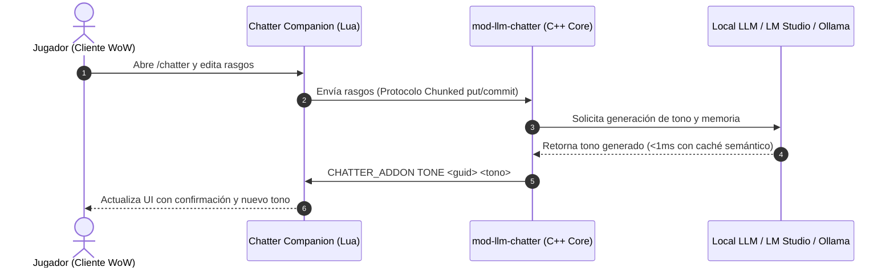

<p align="center">
  
</p>

# 🧠 Chatter Companion — JainaCore Edition
**In-Game AI Personality & Narrative Memory Manager for World of Warcraft (WotLK 3.3.5a)**

<div align="center">

[](https://github.com/DarckRovert/Chatter-Companion)
[](https://github.com/DarckRovert/JainaCore_Server)
[](https://github.com/DarckRovert/mod-llm-chatter)
[](https://github.com/DarckRovert/Chatter-Companion)
[](LICENSE)

</div>

> **Distro Oficial:** Interfaz de usuario para la suite de inteligencia artificial conversacional del ecosistema **JainaCore 3.3.5a**.  
> **Repositorio Oficial:** https://github.com/DarckRovert/Chatter-Companion  
> **Upstream Original:** Basado en el proyecto open-source [Hokken/Chatter-Companion](https://github.com/Hokken/Chatter-Companion).

---

## 📌 ¿Qué es Chatter Companion?

**Chatter Companion** es un AddOn oficial para World of Warcraft 3.3.5a que actúa como puente de control visual para el módulo de servidor [`mod-llm-chatter`](https://github.com/DarckRovert/mod-llm-chatter).

Permite a los jugadores interactuar directamente con la psique de sus compañeros Playerbots:
* **Explorar el Roster de Bots Conocidos:** Visualiza la lista de bots autónomos con los que tu personaje ha interactuado en grupos o bandas.
* **Gestión de Rasgos de Personalidad:** Edita los tres rasgos psicológicos persistentes que definen el comportamiento de cada bot (ej. *valiente, cínico, protector*).
* **Cálculo de Tono en Tiempo Real:** El backend neural deriva y devuelve un perfil de tono coherente según los rasgos asignados.
* **Historias de Fondo Dinámicas (Backstories):** Consulta la biografía narrativa generada por el modelo de lenguaje (LLM) y solicita re-generaciones contextuales con un clic.
* **Soberanía de Memoria:** Olvida selectivamente recuerdos de bots individuales sin alterar su personalidad global.

---

## ⚙️ Arquitectura y Protocolo de Comunicación

Este AddOn **no es un sistema aislado**; se sincroniza bidireccionalmente con el servidor JainaCore mediante el canal de chat con prefijo `CHATTER_ADDON`:



### Protocolo Chunked Anti-Truncamiento
Dado que el motor 3.3.5a limita las líneas de chat a 255 caracteres, **Chatter Companion** implementa un protocolo transaccional en trozos (`put`, `commit`, `cancel`) con codificación segura de caracteres UTF-8 (`~F0`–`~F4`), evitando la desreferenciación `%f` nativa de WoW y garantizando subidas sin pérdidas.

---

## 📥 Instalación

El directorio debe instalarse en la carpeta de AddOns del cliente WoW 3.3.5a:

```
<Ruta_WoW>\Interface\AddOns\Chatter_Companion\
```

### Estructura Requerida de Archivos:
```
Interface\AddOns\Chatter_Companion\
├── Chatter_Companion.toc
├── Chatter.lua
├── ChatterRoster.lua
├── ChatterUI.lua
├── README.md
└── images\
```

1. Coloca la carpeta `Chatter_Companion` dentro de `Interface\AddOns\`.
2. Inicia el juego y en la pantalla de personajes pulsa en **Accesorios** (**AddOns**).
3. Asegúrate de marcar la casilla **"Cargar accesorios antiguos"** (*Load out of date AddOns*).
4. Verifica que `Chatter Companion (Bots LLM)` esté habilitado.

---

## 🎮 Comandos y Uso en el Juego

| Comando | Acción |
| :--- | :--- |
| `/chatter` o `/llmc` | Abre/cierra la ventana flotante principal de gestión de bots y personalidades. |

### Flujo de Trabajo:
1. Agrupa con cualquier bot en el mundo para que sea indexado por `mod-llm-chatter`.
2. Escribe `/chatter` para abrir el editor.
3. Selecciona el bot en la lista izquierda, modifica sus 3 rasgos en los campos de texto y pulsa **Save Traits**.
4. En segundos, el servidor regenerará el tono y actualizará la interfaz automáticamente.

---

## 🛠️ Pruebas Automatizadas de Regresión

El proyecto cuenta con una suite completa de pruebas unitarias para el ciclo de vida de guardado (timeouts, interrupciones, rechazos de servidor y swaps de bots mid-save):

```bash
# Ejecutar localmente con Lua 5.1
lua5.1 tests/run_tests.lua

# O ejecutar mediante Docker aislado
docker run --rm -v "$PWD":/addon -w /addon nickblah/lua:5.1-alpine lua tests/run_tests.lua
```

---

## 📜 Licencia & Créditos

* **Desarrollo y Parches JainaCore:** [DarckRovert](https://github.com/DarckRovert) & Project Jaina Dev Team.
* **Diseño y Arquitectura Original:** [Hokken](https://github.com/Hokken).
* **Licencia:** Distribuido bajo la licencia [GNU General Public License v3.0](LICENSE).
